# 💇 Salon Booking Platform — Frontend

<p align="center">
  
  
  
  
  
</p>

<p align="center">
  A modern salon booking application that connects customers with salons, simplifies appointment scheduling, and provides a smooth booking and payment experience.
</p>

<p align="center">
  <!-- <a href="https://github.com/Dipeshsharma2005/Salon_Booking_Frontend">Frontend Repository</a> • -->
  <a href="https://github.com/Dipeshsharma2005/Salon_Booking_Microservices">Backend Repository</a>
</p>

---

## 📑 Table of Contents

- [Overview](#-overview)
- [Features](#-features)
- [Screenshots](#-application-screenshots)
- [Technology Stack](#-technology-stack)
- [System Architecture](#-system-architecture)
- [Project Structure](#-project-structure)
- [Prerequisites](#-prerequisites)
- [Installation and Setup](#-installation-and-setup)
- [Backend Integration](#-backend-integration)
- [Environment Configuration](#-environment-configuration)
- [Application Workflow](#-application-workflow)
- [Future Improvements](#-future-improvements)
- [Related Repository](#-related-repository)
- [Author](#-author)

---

## 🚀 Overview

The **Salon Booking Platform** is a full-stack web application designed to make salon discovery, service selection, appointment booking, and payment management easier.

The frontend is built with **React and Vite**, providing a responsive user interface that communicates with a Spring Boot microservices backend through HTTP APIs.

Customers can explore salons, view available services, select booking slots, manage their bookings, and proceed through the payment flow. Salon owners have access to a dashboard for salon-related management.

The project integrates modern frontend technologies with a distributed backend architecture to provide a foundation for a scalable salon booking system.

### 🎯 Project Objectives

- Simplify salon discovery and appointment scheduling.
- Provide a clean and intuitive user experience.
- Support booking and payment workflows.
- Provide a dashboard for salon owners.
- Integrate the frontend with Spring Boot microservices.
- Build a maintainable frontend using reusable components and state management.

---

## ✨ Features

### 👤 Customer Experience

- **Salon Discovery:** Browse available salons.
- **Salon Details:** Explore individual salon information.
- **Service Browsing:** View salon services and offerings.
- **Appointment Scheduling:** Select an available booking slot.
- **Booking Management:** View personal bookings.
- **Payment Workflow:** Navigate payment options and payment status.
- **Theme Support:** Home page screenshots are available in light and dark themes.

### 🏪 Salon Owner Experience

- **Owner Dashboard:** Access a dedicated salon management dashboard.
- **Salon Management:** Support salon-related management workflows.
- **Service Management:** Work with service offerings.

### ⚙️ Application Capabilities

- Component-based React architecture.
- API communication using Axios.
- State management with Redux.
- UI components with Material UI.
- Form handling with Formik.
- Fast development and production builds using Vite.
- Integration with a Spring Boot microservices backend.

> Feature availability depends on the corresponding backend endpoints and implementation in the application.

---

## 📸 Application Screenshots

The following screenshots are stored in the [`ScreenShots`](./ScreenShots/) directory.

### 🏠 Home Page

The application home page is available in both light and dark themes.

| Light Theme | Dark Theme |
|---|---|
| 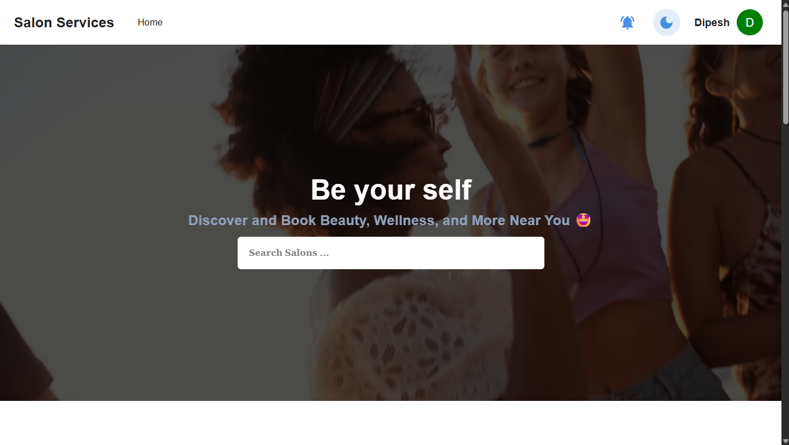 | 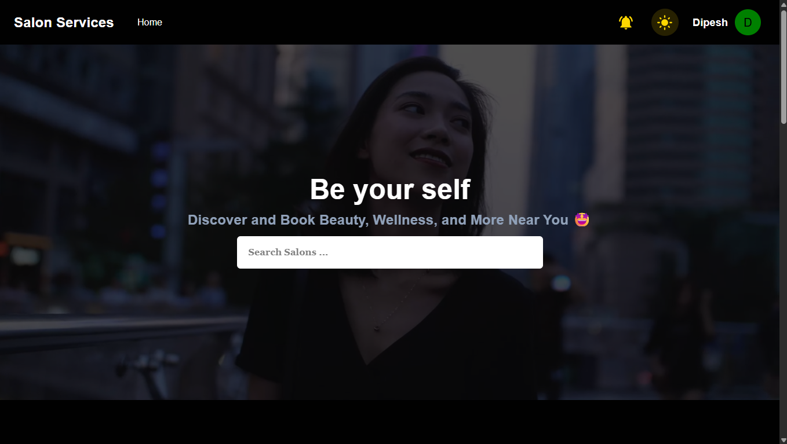 |

### 💇 Salon Discovery

Explore the salon listing and individual salon pages.

| Salon List | Salon Details |
|---|---|
| 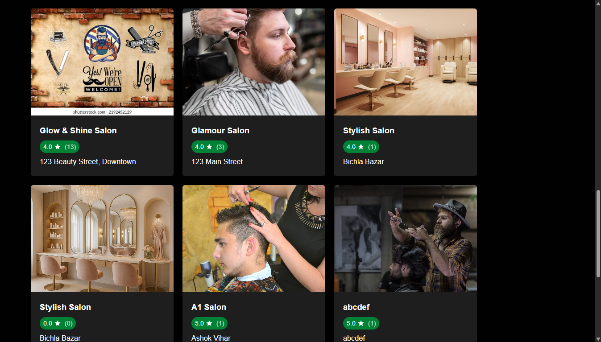 | 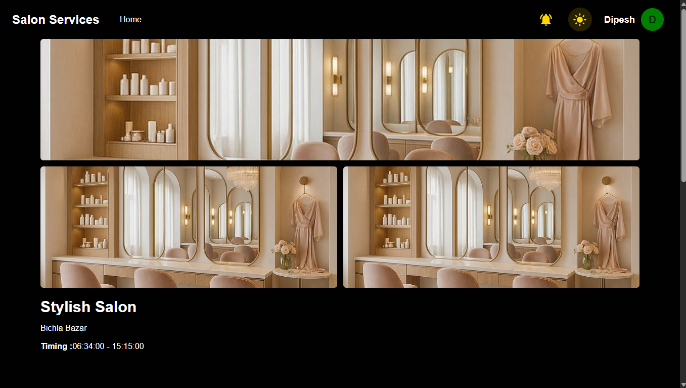 |

### 🛠️ Services and Booking

Browse services and view the available booking slots.

| Services | Service Offering | Booking Slots |
|---|---|---|
| 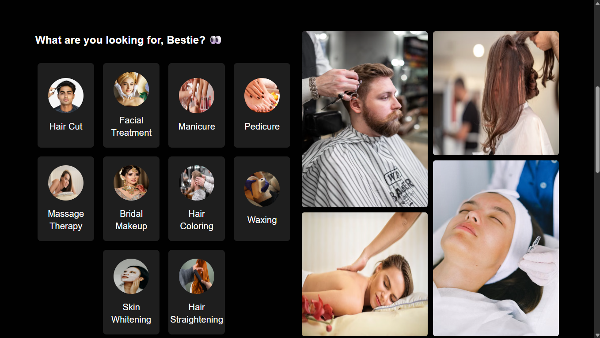 | 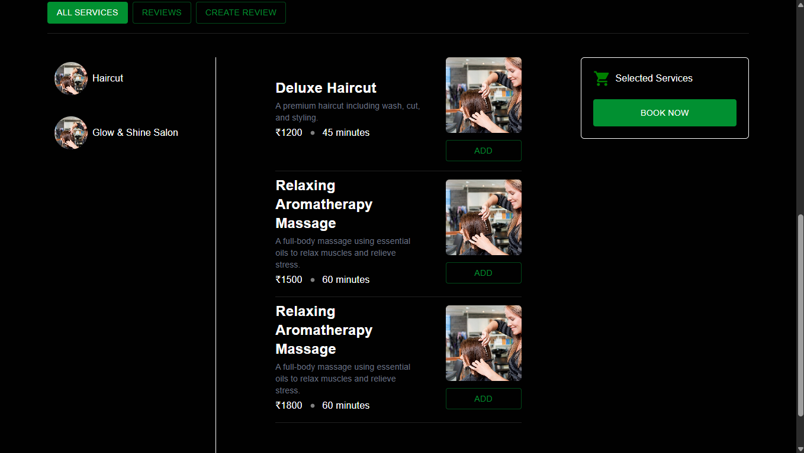 | 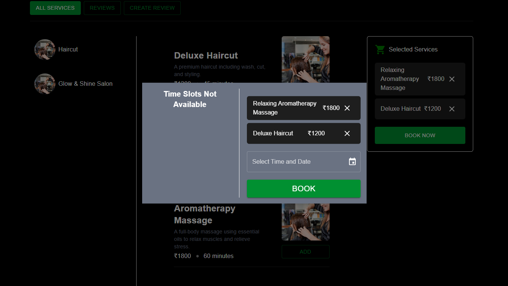 |

### 📅 My Bookings

View the customer booking interface.

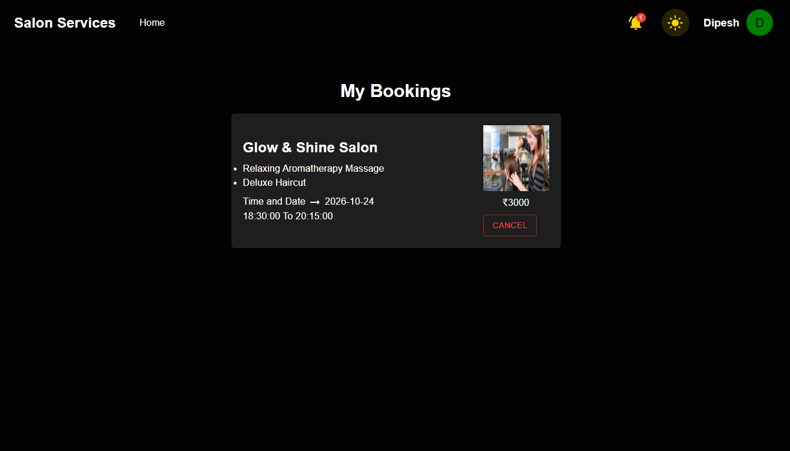

### 💳 Payment Workflow

Screenshots covering the payment options, payment page, and successful payment state.

| Payment Options | Payment Page | Payment Success |
|---|---|---|
| 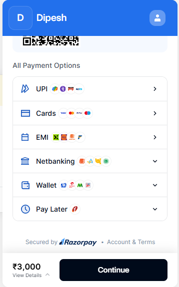 | 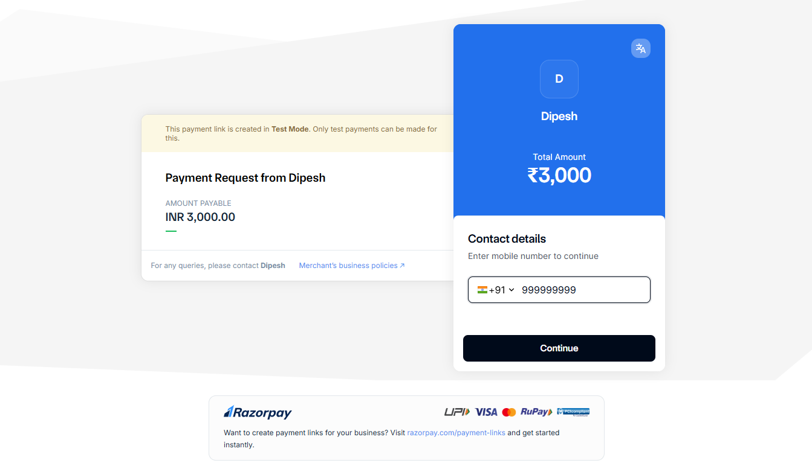 | 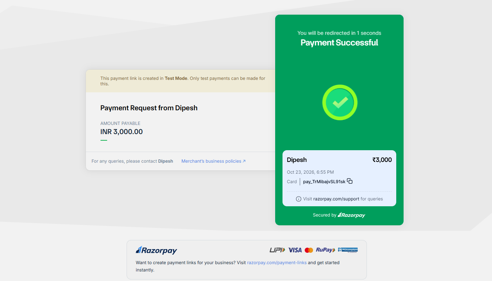 |

### 📊 Salon Owner Dashboard

The salon owner dashboard provides an interface for salon-related management.

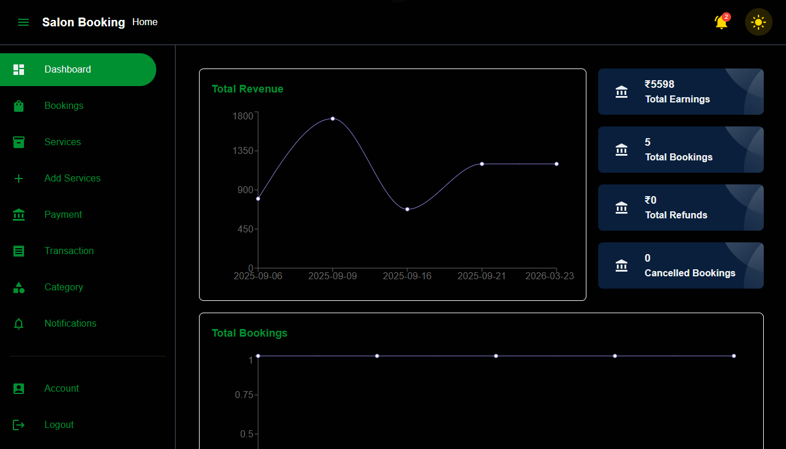

---

## 🧰 Technology Stack

| Technology | Purpose |
|---|---|
| React 19 | Building the user interface |
| Vite | Development server and build tooling |
| JavaScript | Application logic |
| Material UI | UI components and styling |
| Redux | Application state management |
| Formik | Form management |
| Axios | HTTP requests to backend APIs |
| HTML5 | Application structure |
| CSS | Styling and layout |
| Git and GitHub | Version control and source code hosting |

### Backend Technologies

The frontend integrates with a separate backend project that uses the following technologies:

- Java and Spring Boot
- Spring Boot microservices
- PostgreSQL
- Netflix Eureka service discovery
- Spring Cloud OpenFeign
- RabbitMQ messaging
- Keycloak and JWT-based authentication
- WebSocket communication
- Razorpay payment integration
- Docker and Docker Compose

For backend implementation and configuration, visit the [Salon Booking Microservices repository](https://github.com/Dipeshsharma2005/Salon_Booking_Microservices).

---

## 🏗️ System Architecture

The application uses a React frontend connected to a distributed Spring Boot backend.

```text
                  ┌───────────────────────────┐
                  │       User / Customer     │
                  └─────────────┬─────────────┘
                                │
                                ▼
                  ┌───────────────────────────┐
                  │    React + Vite Frontend  │
                  │  Material UI / Redux      │
                  │       Axios / Formik      │
                  └─────────────┬─────────────┘
                                │
                         HTTP / REST APIs
                                │
                                ▼
                  ┌───────────────────────────┐
                  │       API Gateway         │
                  └─────────────┬─────────────┘
                                │
             ┌──────────────────┼──────────────────┐
             │                  │                  │
             ▼                  ▼                  ▼
      ┌─────────────┐    ┌─────────────┐    ┌─────────────┐
      │ User Service│    │Salon Service│    │Booking      │
      │             │    │             │    │Service      │
      └─────────────┘    └─────────────┘    └─────────────┘
             │                  │                  │
             └──────────────────┼──────────────────┘
                                │
                  ┌─────────────┼─────────────┐
                  │             │             │
                  ▼             ▼             ▼
             PostgreSQL     RabbitMQ     Payment Service
                                │
                                ▼
                       Notification Service

             Service discovery: Eureka
             Service communication: OpenFeign
             Authentication: Keycloak / JWT
```

*This is a high-level conceptual overview. Actual service communication and data flow depend on the backend implementation.*

### Architecture Highlights

- **Frontend:** Provides customer and salon owner interfaces.
- **API Gateway:** Acts as the entry point for supported backend APIs.
- **Microservices:** Separate backend responsibilities into independently organized services.
- **PostgreSQL:** Provides relational data storage.
- **Eureka:** Supports service discovery.
- **OpenFeign:** Supports declarative communication between services.
- **RabbitMQ:** Supports asynchronous messaging between configured services.
- **Keycloak/JWT:** Supports authentication and authorization.
- **Payment Integration:** Supports the configured payment workflow.

---

## 📂 Project Structure

The following is a conceptual structure of the frontend repository. The exact component and context filenames may vary in the source code.

```text
Salon_Booking_Frontend/
│
├── public/
│   └── Static assets
│
├── src/
│   ├── assets/
│   │   └── Images and other assets
│   │
│   ├── components/
│   │   └── Reusable UI components
│   │
│   ├── pages/
│   │   └── Application pages
│   │
│   ├── context/
│   │   └── Shared context, if used
│   │
│   ├── redux/
│   │   └── State management, if organized here
│   │
│   ├── services/
│   │   └── API integration, if organized here
│   │
│   ├── App.jsx
│   └── main.jsx
│
├── ScreenShots/
│   ├── BookingSlot.png
│   ├── Home_dark.png
│   ├── Home_light.png
│   ├── MyBookings.png
│   ├── Payment.png
│   ├── PaymentOptions.png
│   ├── PaymentSuccess.png
│   ├── Salon.png
│   ├── SalonList.png
│   ├── SalonOwnerDashboard.png
│   ├── ServiceOffering.png
│   └── Services.png
│
├── .gitignore
├── eslint.config.js
├── index.html
├── package.json
├── package-lock.json
├── vite.config.js
└── README.md
```

> The directory tree illustrates a typical organization. Keep only directories and files that actually exist in your project when documenting the final structure.

---

## 📋 Prerequisites

Install the following software before running the application:

- **Node.js:** A version compatible with your installed Vite version.
- **npm:** Usually included with Node.js.
- **Git:** To clone the repository.
- **Backend services:** Required if you want to use features that call backend APIs.

Verify your installations:

```bash
node --version
npm --version
git --version
```

---

## ⚙️ Installation and Setup

### 1. Clone the frontend repository

```bash
git clone https://github.com/Dipeshsharma2005/Salon_Booking_Frontend.git
```

### 2. Navigate to the project directory

```bash
cd Salon_Booking_Frontend
```

### 3. Install dependencies

```bash
npm install
```

### 4. Configure the backend API URL

Find the file where the frontend defines its backend server URL or Axios base URL.

If your application uses an environment variable, configure it in a local `.env` file at the project root:

```env
VITE_API_BASE_URL=http://localhost:8080
```

This variable name is an example. Use the actual variable referenced in your frontend code, and update API calls or Axios configuration if necessary.

If the application currently uses a hardcoded URL, configure the existing URL in the relevant source file instead.

### 5. Start the development server

```bash
npm run dev
```

Vite will print the local development URL in the terminal, commonly:

```text
http://localhost:5173
```

Open the displayed URL in your browser.

### 6. Create a production build

```bash
npm run build
```

### 7. Preview the production build

```bash
npm run preview
```

The preview command serves the generated production build locally.

---

## 🔌 Backend Integration

The frontend communicates with the backend through APIs. To run the complete application, configure and start the backend services required by the frontend.

**Backend repository:**  
https://github.com/Dipeshsharma2005/Salon_Booking_Microservices

### Integration Checklist

- [ ] Clone the backend repository.
- [ ] Configure PostgreSQL and the required database credentials.
- [ ] Configure the required environment variables and service ports.
- [ ] Start the relevant infrastructure and backend services.
- [ ] Verify that the API Gateway is running.
- [ ] Configure the frontend to use the correct API base URL.
- [ ] Test authentication and the required application workflows.

### Important Configuration Notes

- The API Gateway URL and port must match your backend configuration.
- Any authentication flow must use the correct frontend and backend URLs.
- If cookies are used, configure the backend's CORS and cookie settings appropriately.
- If token-based authentication is used, configure the frontend to send tokens according to the backend's security implementation.
- Payment operations must use the backend's configured payment integration.

---


## 🔄 Application Workflow

A typical customer booking journey is:

1. Open the salon booking application.
2. Explore the available salons.
3. Select a salon and review its details.
4. Browse the available services.
5. Select a suitable booking slot.
6. Review and manage the booking.
7. Continue to the configured payment flow.
8. View the payment result and booking information.

Salon owners can use the relevant dashboard and management screens provided by the application.

The exact steps and available options depend on the implemented frontend routes and backend APIs.

---

## 🧪 Development and Quality

Before submitting changes, run the checks configured in your project.

```bash
npm run build
```

If the following scripts are defined in `package.json`, you can also run:

```bash
npm run lint
npm test
```

These commands depend on the scripts configured in the repository. A test command will work only if the project has an appropriate test script.

Recommended practices:

- Keep components reusable and focused.
- Separate API communication from presentation logic where practical.
- Validate user input.
- Handle API errors and loading states.
- Avoid exposing secrets.
- Test important booking and payment workflows.
- Verify screenshot paths and other README links before committing.

---

## 🚀 Future Improvements

Potential enhancements for the platform include:

- More comprehensive responsive design across devices.
- Improved form validation and error handling.
- Automated frontend component and integration tests.
- Accessibility improvements.
- Better loading, empty, and failure states.
- Enhanced search and filtering for salons and services.
- Additional booking history and management capabilities.
- Production deployment and continuous integration.

These are potential improvements rather than claims about existing functionality.

---

## 🔗 Related Repository

### Backend — Salon Booking Microservices

The backend repository contains the Spring Boot microservices and supporting infrastructure for the platform.

**Repository:**  
https://github.com/Dipeshsharma2005/Salon_Booking_Microservices

**Frontend:**  
https://github.com/Dipeshsharma2005/Salon_Booking_Frontend

---

## 👨‍💻 Author

**Dipesh Sharma**

B.Tech — Computer Science and Engineering  
Gurukula Kangri (Deemed to be University), Haridwar

GitHub: [@Dipeshsharma2005](https://github.com/Dipeshsharma2005)

---


<p align="center">
  ⭐ If you find this project interesting, consider starring the repository!
</p>
